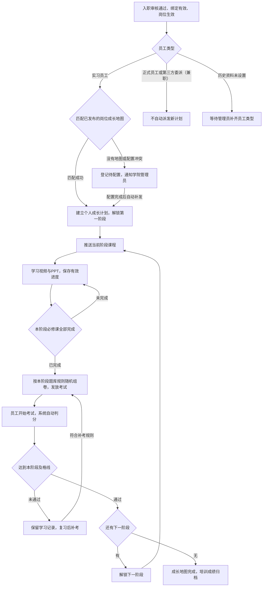

# 学院中心功能方案 V1.2

日期：2026-09-23  
状态：功能与效果图均已确认；员工类型按用户要求明确为“实习员工 / 正式员工 / 第三方委派（兼职）”。仅实习员工自动获得新计划，转为另外两类后已有计划继续到完成；本地实现及浏览器验收已完成，尚未部署。  
本地调研基线：`codex-review` 工作区，提交 `5766908`。本文件描述拟开发能力，不代表已上线。

## 1. 目标与核心流程

实习员工入职审核通过、企业微信绑定有效且岗位任职生效后，系统自动匹配岗位成长地图，依次完成培训和考核，形成可追溯的员工成长档案。正式员工、第三方委派（兼职）不自动获得新的成长计划；已经派发的成长计划在员工改为这两类中的任一类型后仍继续学习、考试、阶段推进和提醒，直到完成。

“自动发放考试”指生成待考任务并通知员工；计时从员工点击“开始考试”时启动。

员工类型检查只决定是否自动派发新计划，不能用于阻断已经派发计划的后续课程、考试、补考和提醒。完成培训也不会自动修改人事中的员工类型。

## 2. 当前项目基础与接入边界

| 当前已核实的本地能力 | 本次接入方式 |
| --- | --- |
| 入职审批一次性创建或更新账号、员工、任职、角色和企微绑定 | 同步增加员工类型确认，在审批事务成功后记录可靠事件；仅对实习员工且绑定/任职有效的人员建立新成长计划 |
| 人事中心维护组织、岗位和员工任职 | 复用正式岗位标识和组织范围，不另建岗位名单 |
| 当前员工配置的 employment_status 仅表示 ACTIVE / INACTIVE，列表显示账号启用或停用 | 新增独立员工类型，贯通员工创建/编辑、入职审核、人员列表和学院派发，不复用账号启停字段 |
| 已有站内通知及企微通知投递机制 | 扩展学院消息类型、授权校验和学院页面直达链接 |
| 导航现有工作台、经营、人事、绩效、财务、配置中心 | 增加学院中心，并在员工工作台展示待学习、待考试入口 |
| 通用工作附件目前支持图片、PDF、DOCX、XLSX，默认上限20 MiB | 增加学院课件上传与媒体处理能力，支持视频及PPT的学习用途 |
| 绩效代码把培训考试数据标记为待接入外部来源 | 本期保存可追溯的培训与成绩记录；是否计入绩效另行配置，不自动影响薪酬或评分 |

上述结论来自本地代码检查，未验证线上部署版本。主要依据：

- `../apps/web/src/app/navigationModel.ts`
- `../apps/web/src/ConfigurationPages.tsx`
- `../apps/web/src/features/organization/PersonnelDirectory.tsx`
- `../apps/core-api/src/main/java/cn/sifangguan/hotelaios/organization/OrganizationModels.java`
- `../apps/core-api/src/main/java/cn/sifangguan/hotelaios/organization/OrganizationService.java`
- `../apps/core-api/src/main/java/cn/sifangguan/hotelaios/integrations/wecom/WeComDirectoryOnboardingAdministrationService.java`
- `../apps/core-api/src/main/java/cn/sifangguan/hotelaios/notifications/NotificationService.java`
- `../apps/core-api/src/main/java/cn/sifangguan/hotelaios/integrations/wecom/WeComDeliveryWorker.java`
- `../apps/core-api/src/main/java/cn/sifangguan/hotelaios/workdata/AttachmentService.java`
- `../apps/core-api/src/main/java/cn/sifangguan/hotelaios/performance/KpiSourcePreviewService.java`

## 3. 页面与使用角色

| 使用者 | 页面 | 主要内容与操作 |
| --- | --- | --- |
| 有员工管理权限的管理员 | 员工创建与编辑 | 新增必填“员工类型：实习员工 / 正式员工 / 第三方委派（兼职）”，显示学院联动说明，并维护变更记录 |
| 有入职审核权限的审核人 | 入职审核 | 在确认岗位时同步确认员工类型，审核通过后按该类型自动检查派发条件 |
| 有人员查看权限的管理者 | 人员列表 | 展示员工类型标签，支持三类分别筛选及历史未设置筛选；学院培训状态单独展示 |
| 员工 | 我的成长地图 | 当前岗位、当前阶段、总进度、已完成与未解锁阶段、学习及考试入口 |
| 员工 | 课程学习 | 视频播放器或PPT逐页阅读、课件清单、有效进度、断点续学 |
| 员工 | 阶段考试 | 考试说明、倒计时、答题卡、自动保存、交卷、成绩及补考说明 |
| 员工 | 学习档案 | 已学课程、各阶段成绩、补考记录、成长地图完成时间 |
| 学院管理员 | 课程库 | 上传视频/PPT，预览处理结果，维护课程版本、时长、页数及知识点 |
| 学院管理员 | 题库 | 新建与批量导入客观题，维护答案、解析、岗位/课程/知识点及难度标签 |
| 学院管理员 | 岗位成长地图 | 选择适用岗位和组织范围，排列阶段，配置课程、组卷规则、及格线及补考规则，发布版本 |
| 直属主管/店总 | 团队学习 | 按授权范围查看员工当前阶段、未完成课程、待考、未通过和逾期情况，进行提醒 |
| 学院管理员 | 学院总览 | 地图配置覆盖情况、参与人数、阶段通过情况、学习逾期与配置异常 |

员工端优先适配企业微信手机使用；课程、题库和地图配置主要使用电脑端。使用现有项目的页面风格和角色权限。

## 4. 岗位成长地图

结构为：岗位成长地图 → 有顺序的培训阶段 → 阶段必修课程 + 阶段考试。

例如“前台员工成长地图”：入职基础 → 前台服务规范 → 入住与收银操作 → 投诉与应急处理。示例仅用于说明结构，正式课程内容和阶段名称由管理员维护。

每个阶段配置：阶段名称、学习目标、课程及顺序、完成期限（可不设）、题库范围、题型数量、分值、及格线、考试时限、补考次数和补考间隔。

- 阶段必须顺序推进。本阶段考试通过之前，后续阶段不可学习或考试；可以看到后续阶段名称和学习目标。
- 阶段内部默认允许自主选择课程顺序，但必须完成全部必修课。
- 通用课程可供多个岗位引用；地图关联明确的课程版本。
- 地图匹配使用正式岗位与组织范围。门店专用地图优先于集团通用地图；同一优先级出现多个匹配时提示配置冲突，不随机派发。
- 发布前校验阶段是否完整、课件是否可用、题量及总分是否满足规则、及格线是否合法。校验失败时不允许发布。
- 已发布版本不原地修改。新员工使用最新有效版本；已有学习计划默认继续原版本，保留历史依据。

## 5. 员工类型、员工配置与自动派发

### 5.1 员工配置同步修改

- 员工资料新增独立字段“员工类型”，业务选项严格为“实习员工”“正式员工”“第三方委派（兼职）”，三者单选。新建员工和入职审核时须明确选择，所有表单、筛选和标签采用相同名称。
- “第三方委派（兼职）”是用户指定的一个完整员工类型，不拆成两个选项，不因某人有兼岗任职就自动认定为这一类型。
- 账号启用/停用、岗位任职、员工类型分别保存和展示。修改员工类型本身不会停用账号、结束任职或更改岗位权限。
- 新建/编辑员工表单显示员工类型及学院联动说明；人员列表增加类型标签和筛选，详情展示修改人、修改时间及类型变化。
- 入职审核在选择岗位时同步确认员工类型，审批成功后写入员工主档；以审核确认值为派发依据。已有员工的类型在重新绑定时保留，不因绑定而被默认覆盖。
- 员工类型由具备员工管理或相应入职审核权限的人员维护；员工自助资料页不能自行切换以规避培训。
- 历史员工缺少此字段时显示“未设置”，这是资料待补齐状态，不是第四个可选员工类型。不擅自推断历史人员的类型，也不触发自动派课；管理员补齐后再判断是否派发。

### 5.2 新计划自动派发规则

- 同时满足“已通过入职/人员审批、员工类型为实习员工、员工和任职有效、绑定有效”后建立计划并推送第一阶段。管理员创建并启用的有效员工不要求额外补走企微入职申请单。
- 正式员工、第三方委派（兼职）或历史员工类型未设置时，不自动创建新计划，不产生新计划的课程、考试、催学或地图缺失提醒。
- 员工从其他类型或历史未设置改为实习员工后，保存成功自动重新检查条件；条件齐备时派发，没有有效绑定或岗位时等待条件齐备。
- 同一员工在同一任职下重复回调、重复审批、重新绑定或反复切换员工类型，不生成第二份相同计划，也不重置已有进度和考试次数；已经完成的该任职计划不因类型切换而重开。
- 对符合派发条件的实习员工，没有匹配地图时，入职流程仍正常完成，学院端记录“待配置”并通知管理员；有效地图发布后重新核验员工类型与任职条件，仅补齐仍符合条件的人员。
- 初次启用学院时，不自动给全部老员工派课；由管理员补齐员工类型后，对符合条件且尚未分配计划的实习员工补发。

### 5.3 已派发计划与状态变化（用户已明确选择）

- **实习员工改为正式员工或第三方委派（兼职）：已有成长计划继续执行到完成。** 课程学习、当前考试、补考、下一阶段解锁和原计划提醒均继续，不因员工类型变化暂停、取消或提前完成。
- 员工编辑页明确提示：“改为正式员工或第三方委派（兼职）后，已派发的成长计划继续执行到完成。”这两类已有计划的员工仍可进入学院完成计划。
- 新计划创建和已有计划推进使用不同的条件：只有创建自动计划时检查员工类型是否为实习员工；已有计划推进检查账号、任职、课程完成和考核条件，不再次要求员工类型为实习员工。
- 培训全部完成仅更新学习档案，不自动把员工改为正式员工或第三方委派（兼职）；员工类型仍由授权人员维护。
- 调岗后终止旧任职下未完成计划的继续推进，并保留档案；只有员工类型仍为实习员工时才按新岗位自动生成新计划。相同课程版本的已完成学习默认可复用，新阶段考试仍需通过。调岗和账号停用属于独立的人事事件，不等同于仅修改员工类型。
- 一人多岗时，员工类型属于员工本人；按有效任职分别建立计划，页面明确归属。相同课程版本无需重复学习，各岗位阶段考核分别完成；改为正式员工或第三方委派（兼职）后已派发的各计划均继续。
- 账号停用、离职或任职失效后停止新阶段派发，并保留已获得的学习和成绩记录。恢复绑定时先重检员工和岗位状态，再续接原计划，不因已转为正式员工或第三方委派（兼职）而阻断原计划。

| 员工情况 | 是否自动创建新计划 | 已派发计划 |
| --- | --- | --- |
| 实习员工，绑定/岗位均有效，已有可用地图 | 是，防止重复创建 | 按原进度继续 |
| 正式员工 | 否 | 如已有计划则继续到完成，无计划则无自动培训待办 |
| 第三方委派（兼职） | 否 | 如已有计划则继续到完成，无计划则无自动培训待办 |
| 实习员工改为另外两类，已有计划 | 否 | 学习、考试、阶段推进和提醒继续到完成 |
| 其他类型或历史未设置改为实习员工 | 条件满足且无同任职计划时创建 | 原计划不重置 |
| 历史员工未设置 | 否，等待管理员补齐状态 | 不凭空创建或取消计划 |
| 账号停用、离职或任职失效 | 否 | 按原人事生命周期规则处理并保留历史 |

## 6. 视频学习规则

用户要求对应的规则：正常倍速观看，禁止跳到未看过的部分，允许回放已看过的部分。

- 播放固定为1倍速，不提供加速功能。
- 进度条仅允许定位到已确认观看的区间；未观看区间保持锁定。回放不会重复增加完成度。
- 自动保存已确认进度；退出后可从保存位置继续。
- 暂停、缓冲、页面进入后台时不累计有效学习时长，切到后台暂停播放。
- 服务端结合播放会话、连续进度和实际经过时间确认学习记录；不能只凭前端上传的“已完成”或最终播放位置完成课程。
- 同一员工只允许一个有效学习计时会话，多标签页、多设备不能叠加刷时长。
- 只有完整覆盖有效视频内容后才标记完成。断网时保留已经确认的进度；未确认片段需联网后重新验证或回看，客户端记录不能直接解锁考试。

这套规则用于验证播放过程和阻止常规跳看；学习掌握程度通过阶段考试检验，系统不会将播放记录等同于员工始终专注。

## 7. PPT学习规则

- 上传PPT/PPTX后转换成适合手机逐页阅读的课件，保留页序和页数。管理员预览并确认转换结果后才可发布。
- 一页一页记录有效浏览状态。课程完成要求每一页都满足浏览条件，不能翻到最后一页就直接完成。
- 建议每页最低有效停留5秒，可按课程统一设置并对单页覆盖；复杂页面可设置更长时间。
- 只有页面处于前台且该页已实际显示时才累计停留；前一页未达标前不能跳到尚未解锁的新页，已读页可回看。
- 学习进度精确到页，跨次继续阅读，不要求每次重新开始。
- 转换结果以静态页面为学习载体；依赖动画、音频或嵌入视频的内容，需要另附视频课程并纳入必修清单，不能在转换后遗漏教学内容。
- 下载或打开原文件不计为线上学习完成。

## 8. 题库与随机考试

- 首期题型建议为单选、多选、判断，支持自动评分；多选默认全部选对才得分，少选、错选不得分，规则在考试前展示。
- 题库按课程、知识点、岗位和难度组织。每个阶段明确选定可用题目范围，默认只考本阶段学习内容；阶段复习题需要管理员显式纳入范围。
- 按“题型数量 + 知识点覆盖 + 难度配比 + 分值”随机抽题，同一张试卷不重复抽到同一道题。
- 本阶段全部必修课完成后，系统生成并锁定一张待考试卷。刷新、退出、再次打开或换设备均返回同一考试记录，不重新抽题。
- 考试开始前展示题量、时限、及格线和剩余次数。点击开始后由服务端确定截止时间，答案自动保存；退出不暂停倒计时。
- 到时按服务端已保存答案交卷；断线后可在截止前继续。提交使用同一考试记录，重复提交不重复计分或推进阶段。
- 试卷保留抽题规则、题目版本、题干、选项、答案、分值和评分规则快照。题库后续修改不改变已发放试卷的成绩依据；答案和解析不得提前返回答题页面。
- 正确答案和完整解析建议在该阶段通过后展示；未通过时先展示错题涉及的知识点与复习课程，避免直接用答案完成下一次考核。
- 题量不足、知识点覆盖不足或题目被紧急停用时，标记“组卷异常”并通知管理员；不混入未学习阶段题目、不静默减少题量、不自动放行。
- 补考重新抽卷，并在题库允许时减少与前次试卷的重复题；不承诺有限题库下每次完全不重复。

## 9. 阶段流转、补考与通知

阶段状态：未解锁 → 学习中 → 待考试 → 考试中 → 已通过；未通过时进入待补考，次数用完进入待处理。

- 得分大于等于本阶段及格线后，自动记录通过、解锁下一阶段、派发新课程并通知员工。
- 未通过时保留课程完成记录，推荐复习对应知识点；按照配置的间隔和次数开放补考。
- 建议默认每阶段最多3次考试（含首次），补考间隔30分钟。管理员可在地图发布前调整。
- 次数用完后通知本人和直属主管，由有权限的学院管理员填写原因并追加考试机会，不直接修改成绩或代替考试放行。
- 最后阶段通过后，个人地图显示“已完成”，保存各阶段成绩和完成时间。
- 站内消息和企业微信消息覆盖：初次派课、考试开放、通过后新阶段、未通过/补考、配置异常；配置截止日期后增加到期提醒。
- 学习计划和考试记录先可靠保存，消息独立重试；消息失败不能导致重复派课、重复试卷或进度回退。
- 通知直达对应课程或考试，打开时重新验证本人身份、任职、计划权限和阶段状态。学习消息默认发给本人，必要的管理提醒发给授权主管。

## 10. 初始参数（已随主方案确认，可在地图发布前配置）

| 参数 | 建议初始值 |
| --- | --- |
| 新计划自动派发对象 | 员工类型为实习员工且绑定/任职有效的人员 |
| 转为正式员工或第三方委派（兼职）后的已派发计划 | 继续执行到完成，包括阶段推进和提醒 |
| 新建员工 / 入职审核的员工类型 | 必填，实习员工 / 正式员工 / 第三方委派（兼职）三选一 |
| 历史员工未设置员工类型 | 不自动派发，待管理员补齐；未设置不是第四个可选类型 |
| 阶段课程完成要求 | 全部必修课完成 |
| 阶段内课程顺序 | 自主选择，阶段之间严格顺序 |
| 视频倍速与跳转 | 1倍速；仅可回看已确认区间 |
| PPT每页最低停留 | 5秒，支持单页调整 |
| 考试满分 / 及格线 | 100分 / 80分 |
| 单次考试时长 | 30分钟 |
| 考试次数 | 每阶段3次，含首次 |
| 补考间隔 | 30分钟 |
| 已完成课程复用 | 仅相同课程版本可复用，阶段考试不免考 |
| 学习期限 | 默认不设强制期限，由阶段配置 |

## 11. 数据与权限设计要点

需要持久保存员工类型及变更记录、课程及课件版本、题目版本、地图及阶段版本、任职对应的个人计划、课程有效进度、考试机会和试卷快照、答题及成绩、阶段流转事件、通知及重试记录。

- 复用现有租户隔离和岗位/组织权限。员工查看自己的学习与考试；主管在授权团队内查看进度与成绩；题库答案仅题库管理权限及符合结果展示条件的本人可见。
- 员工课程访问、完成认定、考试开放、交卷评分及下一阶段解锁均由服务端检查，不能通过直接请求地址绕过。
- 员工类型变更与新计划派发采用可靠事件联动；派发前读取当前有效类型，防止旧事件在已改为正式员工或第三方委派（兼职）后错误创建新计划。已有计划的课程、考试与提醒不套用新计划的实习员工条件。
- 课程上传、地图发布、追加考试机会和计划调整记录操作者、时间、原因及变更前后值。
- 派课、完成、组卷、交卷和解锁分别设计防重复标识和事务边界；可靠事件补偿不能重复产生业务记录。
- 学院媒体采用受身份和课程权限控制的访问方式；处理失败的课件不能作为可发布课程。

## 12. 验收场景与开发顺序

核心验收场景：

1. 实习员工审核绑定并分配岗位后，只生成一份正确的岗位成长计划，并收到第一阶段通知；正式员工、第三方委派（兼职）同样入职后不产生自动培训计划。
2. 未审核、绑定暂停、岗位无效或员工类型未设置时不派发；实习员工缺少地图时可追踪，并在配置后重新核验条件补发。
3. 视频不能加速或跳过未看内容；回放、暂停、后台、断线、多设备不会虚增进度。
4. PPT遗漏任何页或停留未达标时课程不完成；退出重进可继续已确认的进度。
5. 任一必修课未完成时，页面操作和直接调用接口都不能开始阶段考试。
6. 组卷只使用配置范围内的有效题目，数量、分值及覆盖满足规则；刷新不换卷，答案不提前暴露。
7. 低于及格线不解锁下一阶段；等于及格线通过；重复交卷只推进一次。
8. 补考次数、冷却、超时交卷、断线续考和主管提醒按配置执行。
9. 调岗、多岗、地图升级、题库改版及账号停用保留历史且不错误授予权限。
10. 手机企微与电脑端完成全流程，通知失败和服务重启后可恢复且不重复派发。
11. 员工新增/编辑、入职审核、人员列表和详情一致展示三种员工类型，账号启停与员工类型互不混淆，员工不能自行修改。
12. 实习员工改为正式员工或第三方委派（兼职）后，已有计划的当前课程、考试、补考、下一阶段和提醒均正常继续到完成；不会新增其他自动计划或丢失进度。
13. 其他类型或历史未设置改为实习员工后，条件齐备才自动派发；重复保存或反复切换不重复建计划、不重置考试次数。
14. 学院首次启用不会把所有历史员工标记为实习员工；完成培训不会自动修改人事中的员工类型。
15. 第三方委派（兼职）作为一个完整类型保存、筛选和展示；兼岗任职不自动转换员工类型，历史未设置不作为第四个业务选项。

在功能方案和效果图分别确认后，开发按以下顺序推进：

1. 三种员工类型、员工配置与入职审核联动；课程库、题库、岗位成长地图及发布校验。
2. 入职派发、个人成长地图、视频/PPT学习与可信进度。
3. 随机组卷、考试评分、补考和阶段自动推进。
4. 团队看板、通知补偿、权限与全流程验收。

当前效果图覆盖：员工配置与三种员工类型联动、管理端岗位地图与组卷设置，以及员工手机端成长地图、视频/PPT学习、考试和结果页面。课程库、题库、学院总览与团队学习的功能仍按本方案开发。
